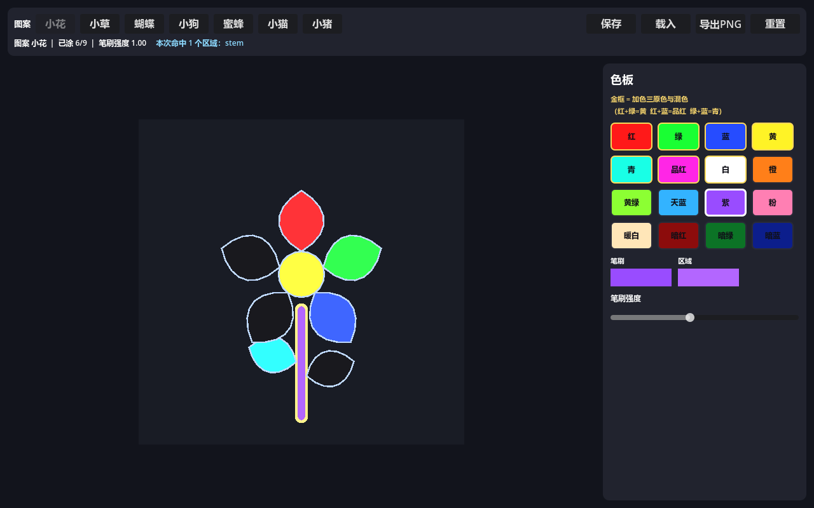

# 003 · Color Garden（光绘花园）

一个用 **Godot 4.7** 做的**涂色游戏**：7 个图案（小花 / 小草 / 蝴蝶 / 小狗 / 蜜蜂 / 小猫 / 小猪），
右侧色板选色，点画布上的区域给它上色，作品可保存 / 载入 / 导出 PNG。

图案不是手画的，而是用 **Blender 4.5** 跑脚本生成出来的区域多边形数据。



---

## 一、三个 demo 重点

### 重点 1 · PhysicsPointQuery 点击检测

点击画布时**不是**遍历多边形做几何判断，而是走 Godot 的物理点查询：

```gdscript
var space := get_world_2d().direct_space_state
var params := PhysicsPointQueryParameters2D.new()
params.position = world_pos
params.collide_with_areas = true
params.collide_with_bodies = false
params.collision_mask = 1 << (ColorRegion.LAYER - 1)   # 层 2
var hits := space.intersect_point(params, MAX_HITS)     # ← 一次返回**所有**命中
```

每个可涂区域是一个 `Area2D`（碰撞层 2）+ `CollisionPolygon2D` + `Polygon2D`（填充）+ `Line2D`（描边）。

**这个 API 的关键特性是「一次返回多个命中」**，所以：
- 顶栏会实时显示「本次命中 N 个区域：a, b, c」——把多命中这件事可视化出来
- 命中的区域会被高亮
- 蜜蜂的**条纹与身体是有意重叠**的，点一下条纹会同时命中两个区域，正好演示这个特性

> 有一条测试专门证明检测**真的依赖物理形状**而不是几何兜底：
> 把某区域的 `collision_layer` 清 0 后，同样的坐标就命中不到了；恢复后又命中。

### 重点 2 · Tween 动画

| 动画 | 实现 |
|---|---|
| 填色脉冲 | `Fx.fill_flash()`：`modulate` 从 1.9（过亮）落回 1.0，0.25s |
| 色板选中脉冲 | `Fx.swatch_pop()`：`scale` 1.0 → 1.18 → 1.0，0.18s |
| 切换图案入场 | `Fx.stagger_intro()`：第 i 个区域延迟 `i*0.02s` 淡入，总时长 `(n-1)*step + duration` |
| 悬停呼吸 | `Fx.float_loop()`：轻微上下浮动并循环 |

**「不堆叠」是硬要求**：每次触发前先 `kill()` 掉上一个 tween（存在成员变量里）。
测试会连调 3 次 `play_fill_flash()` 然后断言活跃 tween 数**恰好为 1**。

### 重点 3 · 加色混合逻辑

涂色是**逐通道相加**，不是覆盖：

```gdscript
static func add_color(base: Color, brush: Color, strength: float) -> Color:
	var s := clampf(strength, 0.0, 1.0)
	return Color(
		clampf(base.r + brush.r * s, 0.0, 1.0),
		clampf(base.g + brush.g * s, 0.0, 1.0),
		clampf(base.b + brush.b * s, 0.0, 1.0),
		base.a)
```

- 同一区域涂红再涂绿 → 两个通道**都**上升，得到黄
- 涂到饱和会夹在 1.0，不会溢出
- 命中多个区域时，**每个区域各自**加一遍

#### 为什么画布是暗底而不是白纸

这不是审美选择，是**物理事实**：加色（additive）是**光**的混合方式。
从白底出发，任何颜色加上去都会立刻饱和成白色，什么也看不出来。
颜料/印刷走的是**减色**混合，那才需要白底。

所以本作用**近黑底 + 发光式涂色**：红 + 绿 = 黄，红 + 蓝 = 品红，绿 + 蓝 = 青，三色加满 = 白。
色板前 7 个色块（带金色描边）就是为此准备的演示色，它们的 RGB 值本身就是加色关系。

---

## 二、怎么运行

```powershell
# 方式 1：命令行
& "C:\Hub\program\godot-4\Godot_v4.7.2-stable_win64.exe" --path .

# 方式 2：用 Godot 项目管理器导入本目录的 project.godot，按 F5
```

## 三、操作说明

| 操作 | 说明 |
|---|---|
| 选色 | 点右侧色板任一色块（金框 = 加色演示色） |
| 上色 | 点画布上的区域；同一区域可反复叠加出混色 |
| 调笔刷强度 | 右侧「笔刷强度」滑块（0.05 ~ 1.0），越大一次加得越多 |
| 切换图案 | 顶栏 7 个图案按钮 |
| 保存 / 载入 | 顶栏按钮，存到 `user://artwork.json` |
| 导出 PNG | 顶栏按钮，导出 512×512 到 `user://artwork.png` |
| 重置 | 清空当前作品 |

---

## 四、目录结构

```
003-color-garden/
├── project.godot
├── README.md
├── LICENSES.md                # 无第三方素材（图形全部由脚本生成）
├── docs/
│   ├── INTERFACES.md          # 接口契约（唯一事实来源）
│   ├── screenshot.png
│   └── .gdignore
├── assets/patterns/           # 7 个区域数据：flower.json ... pig.json
├── tools/
│   └── generate_patterns.py   # Blender bpy 脚本（生成上面 7 个 JSON）
├── scenes/main.tscn           # 唯一场景，根节点挂 scripts/main.gd
├── scripts/
│   ├── palette_def.gd         # PaletteDef：色板 + 加色数学
│   ├── pattern_schema.gd      # PatternSchema：schema 定义与校验
│   ├── pattern_data.gd        # PatternData：读 JSON + 校验
│   ├── color_region.gd        # ColorRegion(Area2D)：一个可涂区域
│   ├── canvas_view.gd         # CanvasView(Node2D)：区域容器 + 点查询
│   ├── artwork_export.gd      # ArtworkExport：扫描线光栅化 + 导出 PNG
│   ├── fx.gd                  # Fx：Tween 工具
│   ├── palette_panel.gd       # PalettePanel：色板 UI
│   ├── hud.gd                 # ColorHud：顶栏
│   ├── main.gd                # 装配层
│   └── autoload/paint_state.gd  # PaintState（autoload）：单一状态源
└── tests/
    ├── test_scene.tscn
    └── test_runner.gd
```

---

## 五、图案数据是怎么生成的

**用 Blender，但不产出 3D 模型。** 本玩法是 2D 涂色，需要的是「可点击填充的封闭区域多边形」，
3D 模型在这里是多余的。所以把 Blender 当作 **2D 几何生成器**：

| 用到的 bpy / mathutils 能力 | 用途 |
|---|---|
| `mathutils.geometry.interpolate_bezier` | 把 4 个控制点插值成平滑的花瓣 / 叶 / 翅 / 尾轮廓 |
| `mathutils.geometry.tessellate_polygon` | 校验多边形是**简单多边形**（能三角化成 n−2 个三角形） |
| `bpy.data.meshes.from_pydata` + `calc_loop_triangles` | 把多边形建成真实网格做**二次**校验 |

```powershell
& "C:\Hub\program\blender 4.5\blender.exe" -b --factory-startup --python tools\generate_patterns.py
```

输出 `assets/patterns/*.json`：

```json
{ "version": 1, "name": "flower", "display_name": "小花", "width": 512, "height": 512,
  "regions": [
    { "id": "petal_0", "label": "花瓣1", "polygon": [[256.0,160.1],[286.4,140.2]], "z": 5 }
  ] }
```

实测产出（脚本自带自检，全部通过后打印 `ALL_OK`）：

| 图案 | 区域数 | 顶点数 |
|---|---|---|
| flower 小花 | 9 | 136 |
| grass 小草 | 7 | 104 |
| butterfly 蝴蝶 | 7 | 126 |
| dog 小狗 | 13 | 246 |
| bee 蜜蜂 | 10 | 176 |
| cat 小猫 | 13 | 234 |
| pig 小猪 | 14 | 260 |

**完全确定性**：脚本不用随机数，跑两次输出逐字节相同（已验证）。

---

## 六、这个项目用到的 Godot 核心概念

1. **`PhysicsDirectSpaceState2D.intersect_point`**：物理点查询，返回**所有**包含该点的形状。
   比几何判断多一个能力——它能一次拿到重叠的多个对象。
2. **`Area2D` + `CollisionPolygon2D`**：`CollisionPolygon2D` 用默认的 `BUILD_SOLIDS` 会自动
   把凹多边形分解成凸形状，所以**凹多边形可以直接用**。
3. **`Polygon2D`**：直接画填充多边形（内部会三角化），比用 `_draw()` 省事。
4. **`Line2D`**：画描边。`joint_mode = LINE_JOINT_ROUND` + 首尾闭合，暗底上才「读得出来」。
5. **`Tween`**：`create_tween()` + `tween_property()` + `set_parallel()` + `set_delay()` + `set_loops()`。
6. **`Image` 手写像素**：`Image.create_empty()` + `set_pixel()` + `save_png()`，
   完全不依赖 GPU，所以 headless 下也能导出作品。
7. **`autoload` 单例**：`PaintState` 是跨模块的单一状态源，任何脚本直接写 `PaintState.xxx` 即可。
8. **`class_name` 静态工具**：`PaletteDef` / `PatternSchema` / `Fx` / `ArtworkExport` 都是纯静态，
   不注册成 autoload。

---

## 七、开发中真实踩到的坑

> 这一节是本次开发**实际发生**的问题，不是教科书条目。

1. **`PhysicsPointQuery` 需要形状先注册进物理空间。**
   刚 `add_child` 完就查询会命中不到——必须 `await get_tree().physics_frame`（我用了两帧）。
   测试里所有点查询前都有这个等待。

2. **点查询用的是世界坐标，不是局部坐标。**
   画布 `CanvasView` 在画布区里是居中的（有偏移），所以必须
   `cv.to_global(局部点)` 之后才能查询。我用局部坐标截了一版图，结果 6 个区域一个都没涂上，
   排查后才反应过来。（游戏里 `main.gd` 用的是 `get_global_mouse_position()`，本来就是世界坐标。）

3. **多个画布会共用同一个物理空间。**
   测试里每个用例都新建一个 `CanvasView`，如果不释放旧的，几个画布的区域会**同时**注册在物理空间、
   坐标还完全重叠——点一下会跨画布命中，`painted_count` 莫名多出几个。
   这不是 bug，是 `intersect_point` 的真实语义；测试之间必须显式释放画布。

4. **`is_equal_approx` 不能用来比较 PNG 像素。**
   PNG 是 8bit/通道，底色 `(0.10, 0.10, 0.12)` 存进去再读回来会变成 `(26/255, 26/255, 31/255)`，
   用精确比较必然失败。比较图像像素一律用**容差**（本项目用 0.01）。

5. **Tween 走的是真实时间，headless 里「等 50 帧」远远不够。**
   入场 Tween 总时长 0.46s，但 headless 帧率极高，50 帧可能只过了 0.05s，
   于是区域还停在半透明状态、颜色被底色冲淡。截图验证时必须用真实时间自旋等待。

6. **`CollisionPolygon2D` 不支持挖洞。**
   所以生成端**禁止** `holes`，需要「洞」就用多个不重叠区域拼出来。schema 校验里专门拦这一条。

7. **过小的区域不好点，但也别把阈值定太死。**
   第一版自检把最小面积定成 200 平方像素，结果猫鼻子（196）和猪鼻孔（149）被拦下。
   这些是真实的小特征——放大一点 + 把阈值放宽到 120 才是对的。

8. **Blender 完全可以在无界面模式下当几何库用。**
   `-b --factory-startup --python xxx.py` 启动只要约 0.5 秒，
   `interpolate_bezier` / `tessellate_polygon` / `from_pydata` 都能正常用，
   比手写坐标可靠得多（尤其三角化校验那一步）。

9. **写测试时，别让多个被测对象共享全局状态。**
   本项目踩的是「多个画布共用一个物理空间」（第 3 条）；
   本质上和「多个 autoload 实例互相干扰」是同一类问题。

10. **「计数型」断言最容易变成同义反复 —— 变异测试抓到了。**
    `active_tween_count()` 最初只保留最后一个 tween 变量，并把返回值**写死成 0 或 1**：

    ```gdscript
    # ✗ 同义反复：即使堆叠了 4 条 tween，它照样返回 1
    func active_tween_count() -> int:
        if _flash_tween != null and _flash_tween.is_valid() and _flash_tween.is_running():
            return 1
        return 0
    ```

    于是「连调 3 次不堆叠」这条断言**永远成立**。
    变异测试（把 `play_fill_flash()` 里"先 kill 旧的"改成 `if false:`，故意制造堆叠）
    跑出来是 **exit 0 / 236 全绿** —— 测试对"不堆叠"这个性质**完全没有保护**。

    改成**真实计数**（记录所有创建过的 tween，逐个查 `is_running()`）后，同一个变异立即产生
    `FAIL ... expected=1 actual=4`。**教训**：断言涉及"数量/上限/是否重复"时，
    计数器本身必须先被证明不是硬编码的——否则断言只是在测一个常量。

11. **`--log-file` 会丢行，核对断言数量要用 stdout。**
    Godot 的 `--log-file` 把 stdout+stderr 合并写入，实测 236 条断言只落盘 213 条 `PASS` 行
    （少了 23 条）。改用 PowerShell 重定向 `> out.txt 2>&1` 后拿到完整 236 条。
    **要核对"到底跑了多少条断言"，以 stdout 为准。**

12. **写测试时警惕"跨用例的状态污染"，但也要分清是谁的锅。**
    我一度以为 `painted_count` 多算 1 是游戏 bug，单独跑却完全正常——
    最后定位到是**测试自己**没释放旧画布（第 3 条）。单独复现是区分"实现 bug"与"测试 bug"的最快手段。

---

## 八、自动化测试

```powershell
& "C:\Hub\program\godot-4\Godot_v4.7.2-stable_win64_console.exe" --headless `
    --path . --log-file "$env:TEMP\cg.log" res://tests/test_scene.tscn
```

实测结果：**`TESTS: 236/236 passed`**，退出码 0，无 `SCRIPT ERROR` / `Parse Error`。

覆盖范围（断言的是**行为**，不只是「节点存在」）：

| 分节 | 内容 |
|---|---|
| A. schema 与数据 | 7 个图案全部通过 `validate_pattern`；区域数逐个核对；id 唯一；坐标在界内；面积 > 0；形心落在自身多边形内；无 `holes` |
| B. 加色数学 | 红+绿=黄 / 红+蓝=品红 / 绿+蓝=青 / 三色=白 **逐通道**断言；强度夹取；`add_many` 与依次 `add_color` 等价；脏数据不崩溃 |
| C. PaintState | 强度上下夹；`apply_to_region` 结果 == `add_color`；连涂两次是**相加不是覆盖**；`reset_region`/`reset_all`；`apply_to_regions` 多命中 |
| D. PhysicsPointQuery | 形心命中；空白不命中；**9 个区域形心全部命中自己**；清 `collision_layer` 后命中不到（证明依赖物理形状）；蜜蜂条纹**一次命中 ≥2 个**区域；`paint_at` 返回值 |
| E. 加色上色 | 红→绿两通道都升；饱和不超 1.0；连续白色叠加接近纯白 |
| F. 存盘 | 往返后 13 个区域颜色**逐通道**还原；4 种脏数据各自返回正确错误码；未知 id / 非法颜色被跳过 |
| G. 导出 PNG | 空作品 0 着色像素；涂色后有非背景像素；**导出像素颜色 == 区域累积色**；角落 == 底色（带量化容差） |
| H. Tween | 连调 3 次活跃 tween **恰好为 1**（不堆叠）；脉冲结束后归零；错峰入场总时长；等满时长后全部 alpha == 1 |
| I. UI | 16 个色块；点色块发出正确信号并更新选中态；4 个操作按钮 + 7 个图案按钮；命中信息文本 |
| J. 主场景装配 | main.tscn 装配出 Hud/Palette/CanvasArea/CanvasView；启动自动加载 flower；**按世界坐标**点查询命中 |

> **测试纪律**（都是踩过的坑，写在契约 §13.1）：
> `_ready()` 里必须 `await` 每个测试函数（漏写会让协程停在第一个 `await`，进程静默结束、
> 退出码 0、无任何报错，而没跑到的断言不计入总数 —— 所以还加了 30 秒看门狗兜底）；
> 边界值一律用**字面量**断言（不拿被测量的常量比自己，避免同义反复）；
> 等真实时间要自旋，不要用 `create_timer` 等短间隔。

---

## 九、想改点什么？从这里下手

| 想做的事 | 改哪里 |
|---|---|
| 改调色板颜色 | `palette_def.gd` 的 `PALETTE` 数组 |
| 改加色公式 | `palette_def.gd` 的 `add_color()`（全工程唯一） |
| 改暗底颜色 | `palette_def.gd` 的 `BASE_COLOR` |
| 改默认笔刷强度 | `palette_def.gd` 的 `DEFAULT_STRENGTH` |
| 改图案形状 | `tools/generate_patterns.py` 里对应 `pattern_xxx()` 的坐标，重跑 Blender |
| 加新图案 | ① 在脚本里加一个 `pattern_xxx()` ② 加进 `PATTERNS` 列表 ③ 加进 `pattern_schema.gd` 的 `PATTERNS`/`DISPLAY_NAMES` |
| 改画布尺寸 | `pattern_schema.gd` 的 `CANVAS_SIZE` + 脚本里的 `CANVAS`（两处要一致） |
| 改动画时长 | `fx.gd` 里各函数的 `duration` 参数 |
| 改点查询上限 | `canvas_view.gd` 的 `MAX_HITS` |
| 改导出尺寸 | `paint_state.gd` 的 `export_png()` 传入的 size |
