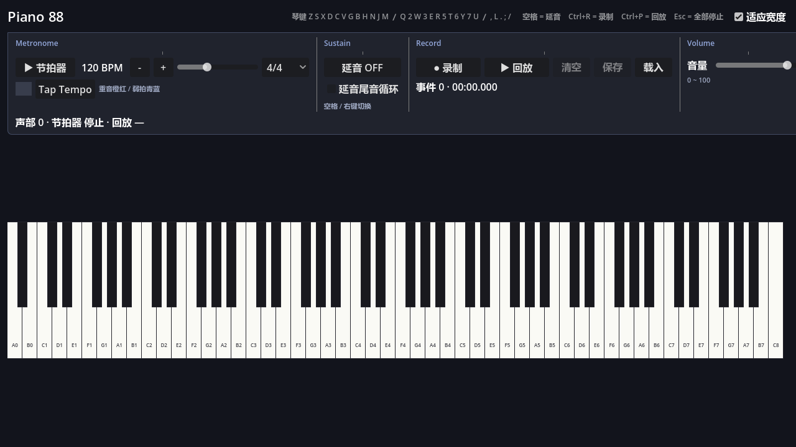

# godot-game-practice

Godot 游戏开发练习集。每个子目录是一个**可以独立运行的 Godot 工程**，编号递增。

| 编号 | 工程 | 内容 |
|---|---|---|
| 001 | [001-learn-about-geometry](001-learn-about-geometry/) | 幼儿「认识几何」答题小游戏（10 题 / 排行榜），含 Blender 4.5 → Godot 4.7 的 GLB 资源管线 |
| 002 | [002-piano](002-piano/) | **Piano 88**：88 键全采样钢琴，带节拍器、延音踏板、演奏录制/回放；音源复刻自 FluidR3_GM（CC BY 3.0） |

## 环境

- **Godot 4.7.x**（必需）
- **Blender 4.5**（仅 001 需要重新导出模型时才用得到）

## 怎么运行

用 Godot 项目管理器导入某个子目录下的 `project.godot`，按 <kbd>F5</kbd>；或命令行：

```powershell
godot --path 001-learn-about-geometry
godot --path 002-piano
```

每个工程的玩法、目录结构、核心概念和踩坑记录，见各自目录下的 `README.md`。

> **002-piano 含第三方音频**：采样授权为 CC BY 3.0，**再分发必须署名**。
> 详见 [002-piano/LICENSES.md](002-piano/LICENSES.md)。



## 说明

`.godot/` 是 Godot 引擎缓存目录，已在 `.gitignore` 中忽略；克隆后第一次打开工程会自动重新生成。
